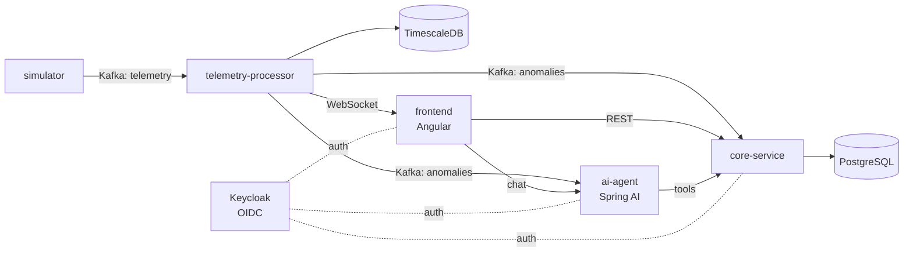

# Predictive Maintenance Platform

Multi-tenant SaaS platform for **industrial predictive maintenance**. Machines stream telemetry
in real time; the platform detects anomalies, shows them on a live dashboard, and an AI agent
explains them, checks technician availability and schedules maintenance.

> Status: **Stage 1 — Foundations (walking skeleton)**, in progress.

## Target architecture



| Service               | Responsibility                                          | Stage |
|-----------------------|---------------------------------------------------------|-------|
| `core-service`        | Multi-tenant SaaS core, REST API                        | 1–2   |
| `frontend`            | Angular app: dashboard, administration, agent chat      | 1–3   |
| `simulator`           | Generates realistic telemetry and injects faults        | 3     |
| `telemetry-processor` | Consumes Kafka, stores time series, pushes via WebSocket | 3–4   |
| `ai-agent`            | Conversational agent with tools                         | 5     |

## Tech stack

- **Backend:** Java 25, Spring Boot 4.1, Maven (wrapper), virtual threads
- **Frontend:** Angular 22 (standalone components, signals, zoneless)
- **Data:** PostgreSQL 18, Flyway; TimescaleDB and pgvector in later stages
- **Messaging:** Apache Kafka (KRaft)
- **Security:** Keycloak (OIDC), tenant isolation
- **Testing:** JUnit, Testcontainers
- **Infra:** Docker Compose locally, GitHub Actions for CI

## Repository layout

```
pom.xml                 # Maven aggregator for services/*
services/<service>/     # one Spring Boot project per microservice
frontend/               # Angular app
infra/compose/          # docker-compose.yml and local configuration
docs/adr/               # Architecture Decision Records
scripts/                # developer tooling
.github/workflows/      # CI
```

## Getting started

### Prerequisites

Java 25, Node.js 24, Docker with Compose. On Ubuntu you can install everything with
[`scripts/setup-dev.sh`](scripts/setup-dev.sh):

```bash
./scripts/setup-dev.sh
```

### Run locally

```bash
cp .env.example .env
docker compose -f infra/compose/docker-compose.yml up -d   # PostgreSQL
./mvnw verify                                              # build and test the backend
./mvnw -pl services/core-service spring-boot:run           # http://localhost:8080
cd frontend && npm ci && npm start                         # http://localhost:4200
```

## Roadmap

1. **Foundations** — monorepo, minimal core-service, minimal frontend, PostgreSQL in Compose, CI.
2. **SaaS core** — tenants, plants, machines, technicians; Keycloak.
3. **Live telemetry** — simulator → Kafka → telemetry-processor → TimescaleDB → WebSocket.
4. **Anomaly detection and alerts.**
5. **AI agent** with Spring AI (web chat; later Telegram/WhatsApp).
6. **Production** — Kubernetes, Prometheus/Grafana, cloud deployment, final documentation.

## Architecture decisions

See [`docs/adr/`](docs/adr/).
